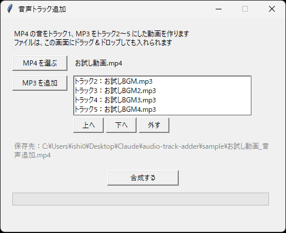

# 音声トラック追加アプリ

MP4 の動画に、MP3 を「別の音声トラック」として足すアプリです。もとの音はトラック1にそのまま残し、選んだ MP3 をトラック2〜5に入れます。再生ソフトで音を切り替えたり、編集ソフトで別々に扱ったりできます。



## できること
- MP4 を1つ、MP3 を1〜4つ選ぶと、音が最大5本入った新しい MP4 を作ります
  - トラック1：もとの MP4 の音（そのままコピー）
  - トラック2〜5：選んだ MP3（並べた順）
- ファイルは、ボタンで選ぶほか、画面にドラッグ＆ドロップしても入れられます（.mp4 と .mp3 を自動で振り分けます）
- 「上へ」「下へ」「外す」で、トラックの並びを直せます
- 合成中は、進み具合を棒と%で表示します
- もとの MP4 は書きかえず、「動画名_音声追加.mp4」として保存します

## 工夫したところ
- **画質が落ちず、速い**：映像ともとの音は作り直さずにコピーし、MP3 だけを AAC（MP4 で一般的な音の形式）に変換します
- **トラックの順番を守る**：ffmpeg の `-map` で並びを指定し、もとの音がいつもトラック1になるようにしました。音が入っていない動画や、すでに音が2本以上ある動画は、理由を出して止めます
- **おかしな使い方でも止まらない**：名前だけ .mp4 のファイル、壊れたファイル、保存できない場所、ffmpeg がないときなど、12通りを試して、どれも理由を出して止まるようにしました。失敗したときは作りかけのファイルを消します
- **画面が固まらない**：合成は別のスレッドで動かし、進み具合はキューで画面に渡します
- **実際に使って直した**：長いファイル名で画面が広がる問題や、トラック名の見え方など、自分の動画で試して見つけた点を直しました

## 使い方
### 必要なもの
- Python 3（3.13 で確かめました）
- [ffmpeg](https://ffmpeg.org/)（動画や音声を扱う道具。`ffmpeg` と `ffprobe` が使える状態にしておきます）
- tkinterdnd2（ドラッグ＆ドロップ用の部品）

```
pip install -r requirements.txt
```

### 起動

```
python app.py
```

`sample` フォルダのお試しファイル（10秒の動画と、音のちがう MP3 が4つ）で、すぐに試せます。

### 画面なしで使う

```
python add_audio.py 動画.mp4 音1.mp3 [音2.mp3 音3.mp3 音4.mp3]
```

### exe にする（Windows）
[PyInstaller](https://pyinstaller.org/) を使うと、ダブルクリックで開ける exe にできます。exe の中に ffmpeg は入らないので、使うパソコンに ffmpeg が必要です。

```
pip install pyinstaller
python -m PyInstaller --onefile --windowed --name audio-track-adder --collect-all tkinterdnd2 app.py
```

`dist` フォルダに `audio-track-adder.exe` ができます。

## ファイル
- `app.py`：画面（ボタン、一覧、ドラッグ＆ドロップ、進み具合）
- `add_audio.py`：合成の部分（ファイルを調べる、ffmpeg で合成する）
- `requirements.txt`：必要な Python の部品
- `sample/`：お試し用の動画と MP3
- `images/screenshot.png`：README の画面写真

## 使ったもの
- Python、tkinter、tkinterdnd2、ffmpeg、PyInstaller
- Claude：1ステップずつ一緒に作り、毎回動かして確かめました
